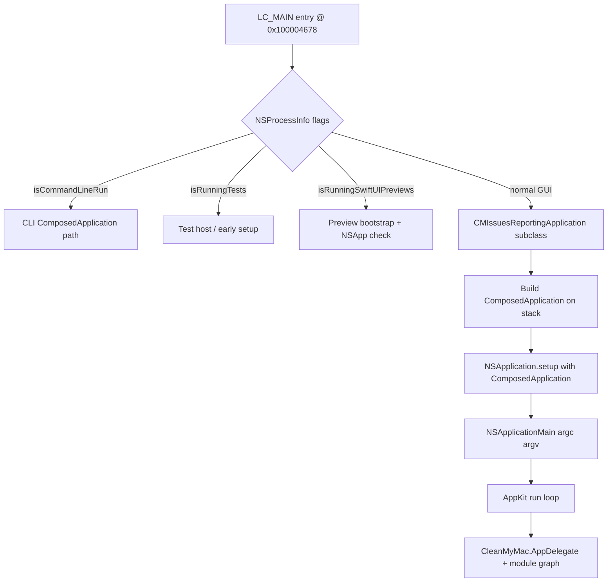

# CleanMyMac 5 (MAS) — REA Structural Analysis Report

**Generated:** 2026-10-12  
**Analyst tooling:** REA MCP (`inspect_macho`, `inspect_plist`, `inspect_artifact`, `demangle_swift`) + macOS static tools (`otool`, `nm`, `strings`)  
**Evidence SHA-256 (universal executable):** `e7861e5dcdbf0c03ae367cf91e4176f26ba187fdb16bd0035fe5e4ee6b301f01`

---

## 1. Target resolution

| Item | Value |
|------|--------|
| User path (placeholder) | `…/CleanMyMac.app/Contents/MacOS/CleanMyMac` |
| **Actual install on this machine** | `/Applications/CleanMyMac_5_MAS.app` |
| **Main executable** | `/Applications/CleanMyMac_5_MAS.app/Contents/MacOS/CleanMyMac_5_MAS` |
| Bundle ID | `com.macpaw.CleanMyMac-mas` |
| Version | **5.7.1** (`CFBundleShortVersionString`), build **50701.0.2609301754** |
| Min macOS | 11.0 |
| Architectures | **Universal:** `x86_64` + `arm64` (fat Mach-O, ~12.8 MiB) |

REA `open_binary` on the `.app` resolves to the Mach-O executable above. Deep decompilation via `procedure_pseudo_code` / `rea decompile` did **not** complete: Hopper bridge launch failed (`Cannot launch Hopper! The handler some object is not defined.`), and Ghidra is not configured (`GHIDRA_INSTALL_DIR` unset). Pseudocode in §5 is **derived from REA-normalized entry metadata + arm64 disassembly + Swift demangling**, not from a live decompiler provider.

---

## 2. High-level application logic

CleanMyMac 5 MAS is a **modular Swift/macOS AppKit** product. The main binary is a thin **composition root**: it wires MacPaw’s shared `ComposedApplication` pattern, selects runtime mode (CLI vs GUI vs tests vs SwiftUI previews), then enters **`NSApplicationMain`**. Feature work lives almost entirely in **`@rpath` dynamic frameworks** under `Contents/Frameworks/`.

### 2.1 Runtime bootstrap flow



### 2.2 Composition & configuration layer

Static strings and Swift type metadata point to an **`ApplicationConfigurator`** module that owns startup wiring:

- `KnowledgeBaseConfigurator`, `LicensePlanManagerConfigurator`, `LoggerConfigurator`, `PreferencesConfigurator`
- `AppGroupContainerMigrator`, `AppGroupFileContainer`
- `CommonRoutingFactory` — dispatches deep links / routes (`MacPawApp`, `Moonlock`, system settings, web URLs)
- Source file references: `CleanMyMac/main.swift`, `ApplicationConfigurator/*.swift`

The GUI shell uses:

- **`CMIssuesReportingApplication`** — custom `NSApplication` subclass (crash/issue reporting hook)
- **`CleanMyMac.AppDelegate`** — conforms to `NSApplicationDelegate` (Swift `@objc` name `_TtC10CleanMyMac11AppDelegate`)

### 2.3 Functional modules (linked frameworks)

REA `inspect_macho` reports **147 linked libraries**, including **94 `@rpath` frameworks**. Representative domains:

| Domain | Frameworks (sample) |
|--------|---------------------|
| UI shell | `MainAppUI`, `NavigationUI`, `DesignSystem`, `SharedUI`, `SettingsUI`, `NotificationsUI` |
| Cleaning / scan | `JunkCleanupModule`, `CleaningCore`, `LegacyScanningCore`, `UninstallerScanning`, `OrganizeModule` |
| Malware / protection | `ProtectionModule`, `PANEngine`, `MalwareScanningRoutines`, `MalwareMonitoringRoutines`, `MalwareRulesRoutines` |
| Performance / space | `PerformanceModule`, `SpaceLensModule`, `SmartCareModule`, `ToolboxModule` |
| Cloud / mail | `CloudStorageModule`, `EmailCleanupModule`, `GmailService`, `GoogleDriveService`, `DropboxService` |
| Assistant | `AssistantModule`, `AssistantDomain`, `AssistantUI` |
| Platform services | `ActivationService`, `AnalyticsService`, `StatisticsService`, `RoutingService`, `NetworkService`, `PreferencesStorage`, `HealthMonitoringAPI` |
| MAS / updates | `MASUpdaterServiceAPI`, `Sparkle` (embedded), `CleanMyMacNFRService` |
| Privilege / system | `PrivilegedOperationsPerformerService`, `PrivilegedRoutines`, `SystemPermissionsKit`, `CleanMyMacLoginItems` |

Scanning/cleanup **engines** (`PantherEngineService`, `PANEngine`, various `*Scanning` frameworks) are separated from **UI modules** (`*Module`, `*UI`), consistent with a service-oriented modular monolith.

### 2.4 Satellite processes

Under `Contents/Library/LoginItems/`:

- `CleanMyMac_5_MAS_HealthMonitor.app`
- `CleanMyMac_5_MAS_Menu.app`

These extend the main app with menu-bar / health monitoring behavior without bloating the primary executable.

### 2.5 URL schemes & integration surface

From REA `inspect_plist`:

- `cleanmymac5`, `cleanmymac5-mas` — activation / multipurpose deep links
- `db-hfn3qmlc7uq9kxd` — Dropbox OAuth callback
- Extensive **TCC usage descriptions** (Downloads, Desktop, Documents, Photos, Contacts, Calendars, Location, Apple Music, etc.) — matches filesystem/mail/cloud cleanup features.

---

## 3. Binary structure (REA `inspect_macho`)

| Property | arm64 slice |
|----------|-------------|
| Format | Mach-O 64-bit executable, PIE |
| UUID | `9E01313F-D270-368D-87FD-E30D0B9D0932` |
| **LC_MAIN entry offset** | `18040` → virtual **`0x100004678`** |
| SDK | macOS 26.5 (Xcode 17F113 toolchain) |
| Runpaths | `@loader_path/../Frameworks`, `@executable_path/../Frameworks`, `/usr/lib/swift` |

Universal fat layout (REA `inspect_artifact`):

- Root: `mach-o-universal` (verified SHA-256)
- Embedded slices: `slices/arm64` @ file offset 6864896, `slices/x86_64` @ 16384

---

## 4. Entry-point disassembly summary (arm64)

Entry **`0x100004678`** (Swift compilation unit **`CleanMyMac/main.swift`**) — key external calls recovered via `otool -tv` + REA `demangle_swift`:

| Address | Symbol / behavior |
|---------|-------------------|
| `0x100004694` | `SharedUtils.ComposedApplication` metadata |
| `0x1000046fc` | `NSProcessInfo.isCommandLineRun` |
| `0x100004738` | `NSProcessInfo.isSandbox` |
| `0x10000478c` | `NSProcessInfo.isRunningTests` |
| `0x1000047a0` | `NSProcessInfo.isRunningSwiftUIPreviews` |
| `0x100004804` | ObjC class **`CMIssuesReportingApplication`** |
| `0x100004898` | `NSApplication.setup(with: ComposedApplication)` |
| `0x1000048b0` | **`AppKit.NSApplicationMain`** |

Literal pool reference at `0x1000048f8`: `"CleanMyMac/main.swift"`.

---

## 5. Primary initialization — reconstructed pseudocode

> **Provenance:** Logical reconstruction from REA Mach-O entrypoint evidence and arm64 disassembly at `0x100004678`. Equivalent to what `procedure_pseudo_code` would target for the process entry thunk leading to `NSApplicationMain`. Names demangled via REA `demangle_swift`.

```c
// Address: 0x100004678 (arm64) — CleanMyMac/main.swift entry (LC_MAIN)
// Custom NSApplication: CMIssuesReportingApplication
// Delegate type (ObjC runtime): CleanMyMac.AppDelegate

int main(int argc, char **argv) {
    // Stack allocation sized for SharedUtils.ComposedApplication (Swift value type)
    ComposedApplication composed;  // metadata: SharedUtils.ComposedApplication

    NSProcessInfo *processInfo = NSProcessInfo.processInfo;
    global_processInfo = processInfo;  // stored @ 0x100557148 (singleton slot)

    if (processInfo.isCommandLineRun) {  // SharedUtils extension
        NSArray *cliArgs = /* bridged from processInfo.arguments */;
        bool sandboxed = processInfo.isSandbox;

        WorkspaceManagement *workspace = [[WorkspaceManagement alloc] init];
        id cliApp = /* build CLI ComposedApplication via 0x100004ce0 */;
        /* run CLI path */
        goto cleanup_and_exit;
    }

    if (processInfo.isRunningTests) {
        /* test harness early path — uses test host classes */
        goto cleanup_and_exit;
    }

    if (processInfo.isRunningSwiftUIPreviews) {
        /* preview-specific bootstrap; may terminate if NSApp already exists */
        if (NSApp != NULL) { goto cleanup_and_exit; }
    }

    // Normal GUI launch
    Class appClass = [CMIssuesReportingApplication class];
    NSApplication *app = /* sharedApplication + dynamic cast to CMIssuesReportingApplication */;

    // Build ComposedApplication configuration (heap object via swift_allocObject)
    ComposedApplication *config = /* factory @ 0x100064a9c, init helpers 0x10004e094/0x10004d3c0 */;

    [app setupWithComposedApplication:*config];  // SharedUtils.NSApplication.setup(with:)

    return NSApplicationMain(argc, (const char **)argv);
}
```

**Interpretation:** MacPaw centralizes dependency injection and module registration inside `SharedUtils.ComposedApplication`. `ApplicationConfigurator` types (seen in symbol table and strings) populate that structure before AppKit takes over. The custom `NSApplication` subclass likely wraps issue reporting before delegate callbacks run.

---

## 6. REA artifact graph (executable-only pass)

`inspect_artifact` on the open target produced a **3-node graph**: universal root + two verified slices. Recommended next probe (REA): `open_binary` with a configured **Ghidra 12.1.x** (thin arm64 slice) or working **Hopper** bridge for function-level pseudocode across `ApplicationConfigurator` and module entry points.

---

## 7. Analysis limitations & next steps

| Limitation | Mitigation |
|------------|------------|
| No provider pseudocode | Set `GHIDRA_INSTALL_DIR` (JDK 21+) and analyze `/tmp/CleanMyMac_5_MAS_arm64`, **or** fix Hopper REA bridge |
| Universal binary | Ghidra v1 requires thinned slice (arm64 thin via `lipo -thin arm64`) |
| Framework internals | Open individual frameworks with REA for per-module decompilation |
| Runtime behavior | Use REA `capture_native_ui_scenario` for activation, scan, and cleanup flows |

---

## 8. REA evidence index

| Operation | Key result |
|-----------|------------|
| `open_binary` | Mach-O arm64 binding attempted; deep analysis blocked on provider |
| `inspect_macho` | Entry `0x100004678`, 147 deps, UUID, segments |
| `inspect_plist` | Bundle metadata, URL schemes, TCC strings |
| `inspect_artifact` | Universal → arm64/x86_64 slice graph |
| `demangle_swift` | `ComposedApplication`, `NSApplication.setup`, `NSApplicationMain` |
