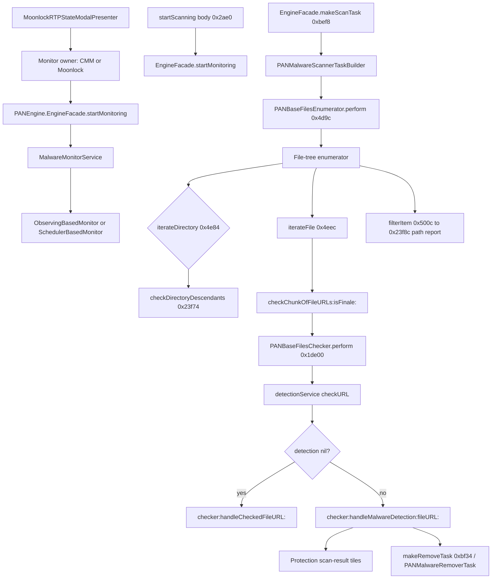

# Real-Time Protection — replica architecture

Module name: **Real-Time Protection** (UI bundle `Features_RealTimeProtection`). Processing is not in that bundle.

Evidence: Mach-O symbols (`nm` / `otool`, arm64) plus three Ghidra 12.1.4 pseudocode functions from the arm64 thin slice of `MalwareScanningRoutines.framework`. Snapshot `/tmp/cmm_msr_arm64.rea-snapshot`. Image base in that session is `0x0` (addresses match `otool` imps). SHA-256 of the slice: `066327bee0da9fe52b87db59043d7b9abafa6878e48c892c5379e4abe4906a4c`. Procedure count reported by overview: 3782.

Ghidra pseudocode is not original source. It shows calls and control flow only.

## UI

Status modal only. Screens, controllers, and assets: `workspace_assets/RTP_ui_map.md`.

- Screen: one modal, two states (`RTP_ByCMM_*` vs `RTP_ByMoonlock_*`), button `Got It`.
- Types in the main app: `MoonlockRTPStateModalView`, `MoonlockRTPStateModalController`, `MoonlockRTPStateModalPresenter`, `RealTimeProtectionState`.
- Ghidra procedures in the main arm64 snapshot (`CleanMyMac_main`): `DebugMenuHandler.showMoonlockRTPModal` at `0x10002f598`; `MoonlockRTPStateModalView` layout at `0x10028cbe8` (`updateConstraints`), `0x10028cd94` (`initWithFrame:`), `0x10028cf24` (`initWithCoder:`). String `showMoonlockRTPModal` at `0x10045bb06`. Preference key `SharedPreferencesKeys.Moonlock.lastSavedMoonlockRTPValue`.
- `initWithFrame:` at `0x10028cd94` only unpacks the `CGRect` and calls `FUN_10028cc24`, then returns `self`. Layout construction is in that helper, not in the initializer.
- Images: `ModalMoonlockIcon`, `ModalMoonlockEnabled`, `ModalMoonlockDisabled`, `ModalMoonlockCMMIcon`.

Separate on-demand Protection screens (`ProtectionScanResultsViewController`, progress / cleanup view models) live in `ProtectionModule`. They display results. They do not contain the directory walk decompiled below.

## Logic (as evidenced)

### 1. Init / who is monitoring

`PantherEngineService.MalwareBackgroundScanner` is constructed with a result queue, `MalwareModelFactory`, statistics, a `Preferences` bag, an analytics tracker, and `isMainAppRunningChecker`. Preferences (symbol signature) include monitor on/off, background scan, DMG/PKG/archive scan, external-drive max size, process-scan and background-scan delays, test mode, skip-checks, and exclude downloaded iCloud files.

Real-time monitor entry points (symbols, not decompiled):

| Address | Symbol |
| --- | --- |
| `PANEngine` `0xc3d0` | `EngineFacade.startMonitoring(settingsProvider:reportsObserver:) -> Bool` |
| `PANEngine` `0xc638` | `EngineFacade.stopMonitoring()` |
| `PANEngine` `0xbef8` | `EngineFacade.makeScanTask(configuration:) -> PANMalwareScannerTask?` |
| `PANEngine` `0xbf34` | `EngineFacade.makeRemoveTask(configuration:malwareContainer:) -> PANMalwareRemoverTask?` |
| `MalwareMonitoringRoutines` `0x1027c` | `MalwareMonitorService.startMonitoring(settingsProvider:reportsObserver:)` |
| `PantherEngineService` `0x68cc` | protocol thunk `MalwareBackgroundScannerType.startScanning() throws` |
| `PantherEngineService` `0x2b90` | witness wrapper; calls the body at `0x2ae0` |
| `PantherEngineService` `0x2ae0` | `startScanning` body: weak-load settings + observer, call `EngineFacade.startMonitoring` |
| `PantherEngineService` `0x2bb0` | paired `stopScanning` body: calls `EngineFacade.stopMonitoring` |

`MalwareMonitorService` also implements gates: scan DMG/PKG/archive, external drive, acceptable URLs, cloud-files process mode, and callbacks `scanner(_:didScanPath:)`, `monitor(_:didDetectMalwareItems:)`. ObjC monitors in the same framework: `PANObservingBasedMonitor`, `SchedulerBasedMonitor` (dispatch thunk `startMonitoring` at `0x5518` and `0x1389c`).

The exported `startScanning` symbol at `0x68cc` is only the protocol thunk (`ldr` witness+8, `blr`). Procedure search in the Panther arm64 snapshot finds that name only at `0x68cc`. The conforming type is the private class `_MalwareBackgroundScanner` (Swift protocol-conformance record at `0x190e0`, type descriptor `0x1dad4`). The only call to `EngineFacade.startMonitoring` in this binary is `bl` at `0x2b2c` inside `0x2ae0`. Metadata at `0x20a10` points at wrapper `0x2b90`, which calls `0x2ae0` and returns. That pair is the implementation.

`0x2ae0` (evidence `ev_1ad4e8248ce1b0dc9f14be9558223229821b10ea29fbb6ebe29077dad4f76883`): from the object at `self+0x10`, weak-load the reports observer (`+0x18`) and the settings provider (`+0x10`). If either load is nil, or `startMonitoring(settingsProvider:reportsObserver:)` returns false, allocate `MalwareBackgroundScanner.Errors` and throw. The only error case symbol on that type is `failedToStart`. A true return leaves the function without throwing. `0x2bb0` is the matching stop path: it calls `EngineFacade.stopMonitoring` and returns. Neither function builds a scan task or walks files.

### 2. File walk

Binary: `MalwareScanningRoutines` arm64, class `PANBaseFilesEnumerator` (protocol `PANFilesEnumerator`). Subclasses seen: `PANPlainFilesEnumerator`, `PANBundleFilesEnumerator`.

`-[PANBaseFilesEnumerator perform]` at **`0x4d9c`** (evidence `ev_a9e525380cadc1e42ac88e0388bd6fa7a549906c3b43ab86434c41cc2cf79d53`):

1. Read `maxFileURLsChunkSize`.
2. Allocate `fileURLsContainer` as `NSMutableArray` with that capacity.
3. `makeFileTreeEnumerator`, set self as its delegate, `perform` that enumerator.
4. Copy the URL container and call delegate `enumerator:checkChunkOfFileURLs:isFinale:` with finale = true.

Directory step `enumerator:iterateDirectoryWithURL:` at **`0x4e84`** (evidence `ev_08f6a2592783d61a8416ef5b3b884c2d76cb883a2046af3d4c6353e2d4bead97`) forwards to the delegate as `enumerator:checkDirectoryDescendantsWithURL:` and returns that BOOL. That is the descend / skip gate.

`enumerator:iterateFileWithURL:` at **`0x4eec`** (evidence `ev_07e77a1ba83ef542d0ff29742488320f04ff6ddf976e4ae8946f57601ceda15a`): resolve the URL with `URLByResolvingSymlinksInPath`. If that returns non-nil, append it to `fileURLsContainer`. If the container count is greater than `maxFileURLsChunkSize`, copy the container, call delegate `enumerator:checkChunkOfFileURLs:isFinale:` with finale false, then `removeAllObjects`. The finale-true flush stays in `perform`.

`enumerator:filterItemWithURL:` at **`0x500c`** (evidence `ev_fea7a584543df12d09f5b278e8b38207330ce23d7a68aaf65ad0f78422f1161c`) is a void forward to the same selector on the delegate. It does not return a keep/drop bit.

The delegate implementation of the descend gate is `-[PANURLBaseMalwareDetectionTask enumerator:checkDirectoryDescendantsWithURL:]` at **`0x23f74`** (evidence `ev_22ab5f1e4df3c1882b7ae7a00b6b0fa6bad6fedf4bf3bc93ff6ee1ebafd481e3`). It returns the inverse of `enumerator:shouldDropCheckingDescendantsForDirectoryWithURL:`. That helper at **`0x23df8`** (evidence `ev_55a5e9feb52c70cb7c4416e43c6afff695368ce58fdd4a25ec56af6bd617ce82`) returns false on this base class, so the base task always descends. Subclass overrides of the drop helper were not decompiled.

The same task's `enumerator:filterItemWithURL:` at **`0x23f8c`** (evidence `ev_b690638e5b24a975bfe5a9e62c61779f3856801712f66c6210a45a2e82926d94`) reads `textualProgressReporter` and `report:`s the URL path. No detection call. `enumerator:catchError:` at `0x5068` is still not decompiled.

Ivars: `delegate`, `_maxFileURLsChunkSize`, `_fileURLsContainer`, `_errorsContainer`, `_scannedURLsTrace` (`PANURLsTrace`), `_executionControl`.

### 3. Per-file check and result callback

`-[PANBaseFilesChecker perform]` at **`0x1de00`** (evidence `ev_feaf0ffaf58d3f9572da20a79ec2e01a217d440226cb181f8886d9cc8435dc95`).

Loop shape:

1. Tell `numericProgressReporter` the URL count (`addExpectedUnitsCount:`).
2. Fast-enumerate `fileURLs`.
3. Each URL: `executionControl sleepIfPausedOrExitIfCanceled`. If the return is nonzero, leave the loop.
4. Wrap the URL in a stack block and call `PANFreezeDetector detectFreezeWithUserInfo:`.
5. `isCheckable:`. If false, skip detection.
6. If checkable, `detectionService checkURL:executionControl:dataSource:error:`. On a nil detection plus a non-nil error, `pan_notifyError:`.
7. `textualProgressReporter report:` with the path. Increment numeric progress. `PANFreezeDetector cancel:`.
8. Delegate: `checker:handleCheckedFileURL:` when detection is nil, else `checker:handleMalwareDetection:fileURL:`.

`detectionService` is an injected object. Its `checkURL` body was not decompiled. Rule bytes, signatures, and match criteria are out of scope for a replica of the pipeline shape.

`EngineFacade.makeScanTask` at **`0xbef8`** (evidence `ev_a1eb5a71269324c308788d8a8870228b777d28c64431631a42087fa3b0c0e673`, PANEngine arm64 SHA-256 `7c2e328ccfc09e5ffbcefdc5ca0115b8575eea9796dc40a16772768fa1280b15`) runs a `swift_once` initializer, then `0xf4f0`. That helper locks the facade, reads `engineState`, and unlocks. If the state value is below 2, it resolves `PANMalwareScannerTaskBuilder` and sends `makeScanTaskWithConfiguration:` with the caller's `PANScanConfiguration`, and returns that object. State 2 returns nil. Any other state hits a trap. The returned object is a `PANMalwareScannerTask`. The builder body was not kept: it is where database and rule providers are assembled, which is outside this control-flow pass.

`EngineFacade.makeRemoveTask` at **`0xbf34`** (evidence `ev_e3bb4706840e3075e3f650667f4ff7039df6ed9dd77adfdb0607b3b1a40140c7`) is a separate entry. After the same `swift_once`, `0xbfb4` uses the same state gate, resolves `PANMalwareRemoverTaskBuilder`, and sends `makeRemoveTaskWithConfiguration:malwareContainer:` (`PANRemovalConfiguration` plus the malware array). It returns that `PANMalwareRemoverTask` or nil. Deletion and quarantine inside the remover were not decompiled. The scan loop above does not delete; it reports a detection object to the checker delegate. Class `PANDiskURLMalwareItemRemovalService` still exists in the routines binary and was not opened.

### Data flow

## Replica vs MacPaw-specific

A custom replica of this feature must implement:

- A two-state status modal: this app is monitoring, or another product is and this monitor stays off.
- Preference flags for monitor, background scan, disk images, packages, archives, external-drive size cap, delays, and iCloud-download exclusion.
- A cancellable file-tree walk that buffers URLs in chunks (`maxFileURLsChunkSize`) and asks a delegate before descending into a directory.
- A per-URL loop with pause/cancel, progress (count + current path), and a pluggable `checkURL` that returns either “clean” or a detection object.
- A separate removal task. Do not delete inside the enumerator.

MacPaw-specific (do not copy as if it were the algorithm):

- Moonlock coexistence, bundle id strings `S8EX82NJP6.com.macpaw.moonlock-mas` / `moonlock.interoperability`, cross-promo tiles, and analytics trackers.
- `PAN*` class layout, freeze detector, privileged-access enumerator adapter, and the closed detection-service implementation.
- Ghidra names like `objc_stub::` and injected retain fixups.

## Evidence limits

- `checkURL:executionControl:dataSource:error:` was not opened. The checker passes the file URL, the execution-control object, a nil data source, and an error out-pointer. Nothing in this note is a detection rule or a bypass.
- `PANMalwareScannerTaskBuilder.makeScanTaskWithConfiguration:` was decompiled only far enough to see the facade call it, then discarded. Rule-provider and signature-service construction stays out of the excerpts.
- `startMonitoring` inside `MalwareMonitoringRoutines` and `didScanPath` remain symbol-level. The Panther body that calls the facade is recovered; the monitor implementation is not.
- Pseudocode omitted ARC traffic in the narrative. Raw excerpts:

  - `excerpts/PANBaseFilesEnumerator_perform_0x4d9c.c`
  - `excerpts/PANBaseFilesEnumerator_iterateDirectory_0x4e84.c`
  - `excerpts/PANBaseFilesEnumerator_iterateFile_0x4eec.c`
  - `excerpts/PANBaseFilesEnumerator_filterItem_0x500c.c`
  - `excerpts/PANURLBaseMalwareDetectionTask_checkDirectoryDescendants_0x23f74.c`
  - `excerpts/PANURLBaseMalwareDetectionTask_shouldDropDescendants_0x23df8.c`
  - `excerpts/PANURLBaseMalwareDetectionTask_filterItem_0x23f8c.c`
  - `excerpts/PANBaseFilesChecker_perform_0x1de00.c`
  - `excerpts/EngineFacade_makeScanTask_0xbef8.c`
  - `excerpts/EngineFacade_makeScanTask_stateGate_0xf4f0.c`
  - `excerpts/EngineFacade_makeRemoveTask_0xbf34.c`
  - `excerpts/EngineFacade_makeRemoveTask_stateGate_0xbfb4.c`
  - `excerpts/MalwareBackgroundScanner_startScanning_witness_0x2b90.c`
  - `excerpts/MalwareBackgroundScanner_startScanning_0x2ae0.c`
  - `excerpts/MalwareBackgroundScanner_stopScanning_0x2bb0.c`

- Main executable RTP types are string/metadata evidence. Static analysis did not observe a live scan.
