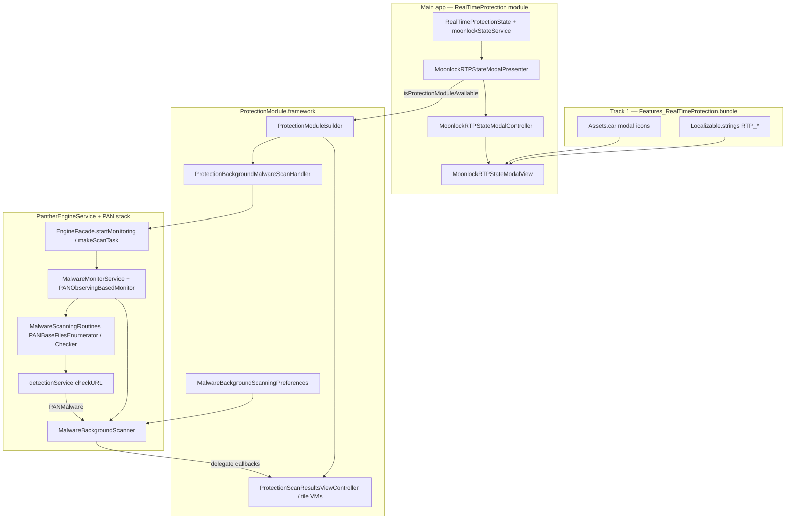

# BLUEPRINT — Real-Time Protection (`Features_RealTimeProtection`)

## Summary

MacPaw splits **RTP UX** (small resource bundle + Swift modal in the main app) from **malware engine** (Panther/PAN stack). The bundle only supplies copy and artwork for a two-state “who monitors” dialog. Continuous protection is `PantherEngineService.MalwareBackgroundScanner` + PAN monitors; on-demand results UI is `ProtectionModule`.

**Track 1 assets:** see `workspace_assets/RTP_ui_map.md`, `utility_RealTimeProtection_*.json`, `utility_RealTimeProtection_en_Localizable.strings`.

**Track 2 logic:** `02_RealTimeProtection_logic.md`, deep walk in `02_RealTimeProtection_ARCHITECTURE.md`.

---

## Layer diagram

---

## Data flow

| Stage | Inputs | Processing | Outputs |
| --- | --- | --- | --- |
| Coexistence | Moonlock install/active, keychain group, shared prefs | `moonlockStateService`, RTP modal presenter gates | User sees CMM vs Moonlock copy; CMM monitor enabled/disabled |
| Monitor config | `MalwareBackgroundScanningPreferences`, watcher timing | DMG/PKG/archive/PUA flags, external drive cap, delays | Monitor start/stop, background scan schedule |
| `startScanning` `0x2ae0` | Weak settings provider and reports observer on the private scanner | Witness `0x2b90` calls this body. Both refs required. Then `EngineFacade.startMonitoring`. Nil ref or false return throws `MalwareBackgroundScanner.Errors` (`failedToStart`). Protocol thunk `0x68cc` only jumps through the witness. | Monitor running, or a thrown start error. Does not walk files. |
| `makeScanTask` `0xbef8` | `PANScanConfiguration` | `swift_once`, then `0xf4f0` locks the facade. Engine state below 2 asks `PANMalwareScannerTaskBuilder` for `makeScanTaskWithConfiguration:`. State 2 returns nil. | `PANMalwareScannerTask` or nil. Builder internals not retained. |
| `iterateFileWithURL:` `0x4eec` | File URL from the tree walker | Resolve symlinks, append to the chunk array. Over `maxFileURLsChunkSize`, flush `checkChunkOfFileURLs:isFinale:` with finale false and clear the array. | Chunk of file URLs, or a partial flush |
| `filterItemWithURL:` `0x500c` | Item URL | Void forward to the delegate. On `PANURLBaseMalwareDetectionTask` at `0x23f8c`, that reports the path to `textualProgressReporter`. | Progress path string. Not a keep/drop bit. |
| `checkDirectoryDescendantsWithURL:` `0x23f74` | Directory URL | Delegate on `PANURLBaseMalwareDetectionTask`. Returns the inverse of `shouldDropCheckingDescendants` at `0x23df8`. Base class always returns false from the drop helper, so this base task always descends. | BOOL descend |
| Scan task | URL lists, chunk size | Enumerator chunks → `PANBaseFilesChecker.perform` `0x1de00` | Detections or clean callbacks |
| `checkURL` boundary | File URL, execution control, nil data source, error out-pointer | Called only when `isCheckable:` is true. Body not decompiled. | Detection object or nil, plus optional error |
| `makeRemoveTask` `0xbf34` | `PANRemovalConfiguration`, malware array | Separate from the scanner. `0xbfb4` uses the same engine-state gate and asks `PANMalwareRemoverTaskBuilder` for `makeRemoveTaskWithConfiguration:malwareContainer:`. | `PANMalwareRemoverTask` or nil. Removal internals not decompiled. |
| User remediation | Selected malware nodes | `MalwareRemovalTaskFactory`, privileged agent | Quarantine/remove; cleanup complete UI |

---

## UI → logic mapping

| UI surface | Controller / presenter | Service | Engine |
| --- | --- | --- | --- |
| RTP status modal | `MoonlockRTPStateModalPresenter` | `moonlockStateService`, `ProtectionModuleBuilder` | Monitor enable flag (not in bundle) |
| Smart Care Protection tile | `ProtectionTilesScreenCoordinator` | `ProtectionBackgroundMalwareScanHandler` | `MalwareBackgroundScanner` |
| Scan results | `ProtectionScanResultsViewController` | `ProtectionScanningModelFactory` | `makeScanTask` + enumerators |
| Malware found / not found tiles | Tile view models | `MalwareTilesMapper` | Detection callbacks |

---

## Minimal replica components

1. **Resource bundle** — 4 images + 5 string keys (no code).
2. **Modal module** — presenter with explicit gating rules mirroring log strings; two-state enum.
3. **Preferences store** — boolean monitor + background scan + scan-type flags.
4. **Monitor adapter** — start/stop + delegate protocol (`didScanPath`, `reportNewMalware`).
5. **Scan pipeline** — chunked directory walk, cancellable checker loop, pluggable `checkURL`.
6. **Removal task** — separate from walk; optional for MVP.

Skip for filtered replica: Moonlock cross-promo, analytics trackers, intro gating (unless testing modal only).

---

## Related files (this RE pass)

| File | Purpose |
| --- | --- |
| `workspace_assets/utility_RealTimeProtection_assets.json` | Full `assetutil --info` dump |
| `workspace_assets/utility_RealTimeProtection_ui_controllers.json` | VC/presenter inventory |
| `workspace_assets/utility_RealTimeProtection_nib_decode.json` | NIB absence record |
| `binary_logic/features_decompile/02_RealTimeProtection_logic.md` | Ghidra addresses (this session) |
| `binary_logic/features_decompile/02_RealTimeProtection_ARCHITECTURE.md` | Enumerator/checker decompile |
| `binary_logic/features_decompile/03_SCAN_PIPELINE_CLOSED.md` | End-to-end control flow and remaining unknowns |
| `binary_logic/features_decompile/excerpts/*` | Raw pseudocode excerpts |
